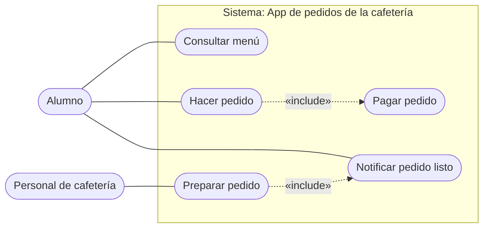

# Paso 1: Diagrama de casos de uso – App de pedidos de la cafetería

## Actores
- **Alumno**: consulta el menú, hace pedidos, paga y recoge.
- **Personal de cafetería**: prepara los pedidos y avisa cuando están listos.

## Casos de uso
1. Consultar menú
2. Hacer pedido (incluye *Pagar pedido*)
3. Pagar pedido
4. Preparar pedido (incluye *Notificar pedido listo*)
5. Notificar pedido listo

## Diagrama
> Mermaid no tiene diagrama de casos de uso nativo, por lo que se representa con un `flowchart`: los actores son los nodos redondeados, el rectángulo es el **límite del sistema** y las flechas punteadas son las relaciones «include».

