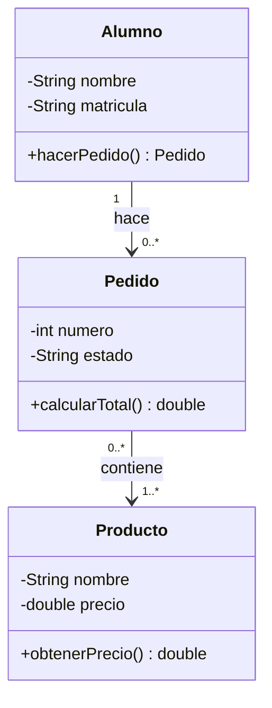

# Paso 2: Diagrama de clases – App de pedidos de la cafetería

## Clases, atributos y métodos
| Clase | Atributos | Método |
|---|---|---|
| Alumno | `-nombre: String`, `-matricula: String` | `+hacerPedido(): Pedido` |
| Pedido | `-numero: int`, `-estado: String` | `+calcularTotal(): double` |
| Producto | `-nombre: String`, `-precio: double` | `+obtenerPrecio(): double` |

Visibilidad: `+` público, `-` privado.

## Diagrama

## Multiplicidad
- Un **Alumno** hace **0 o muchos** Pedidos; cada Pedido pertenece a **un** Alumno.
- Un **Pedido** contiene **uno o muchos** Productos; un Producto puede aparecer en **0 o muchos** Pedidos.
