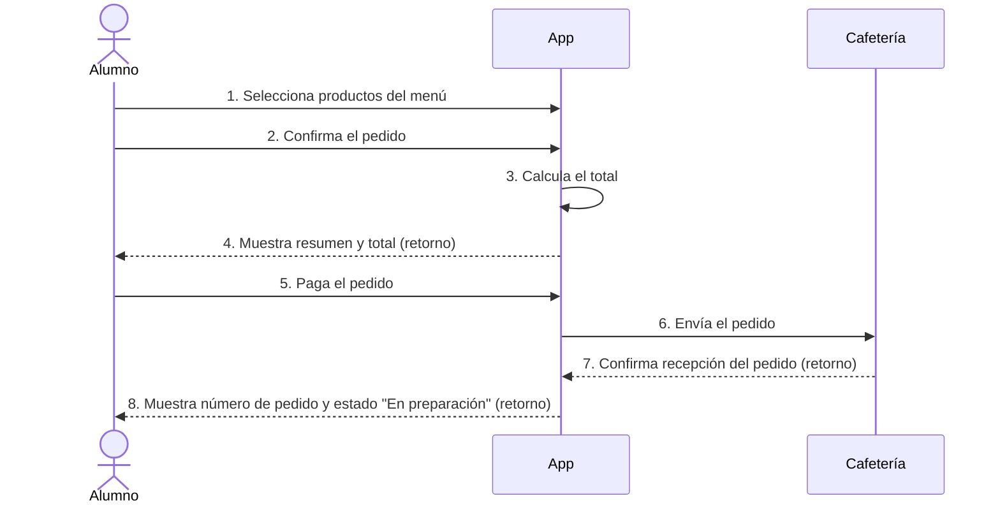

# Paso 3: Diagrama de secuencia – Escenario "Hacer un pedido"

## Líneas de vida
Alumno, App y Cafetería.

## Diagrama

## Mensajes
- **Mensajes de llamada:** 1, 2, 3, 5 y 6.
- **Mensajes de retorno (línea punteada):** 4, 7 y 8.
